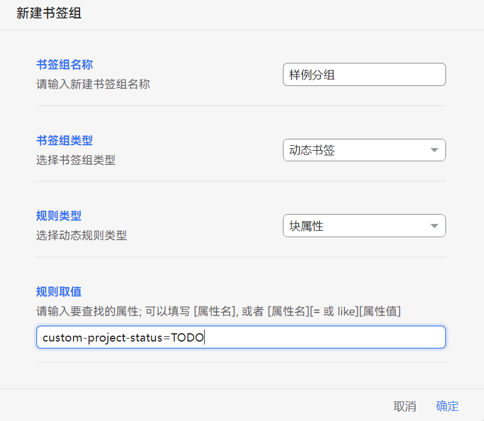
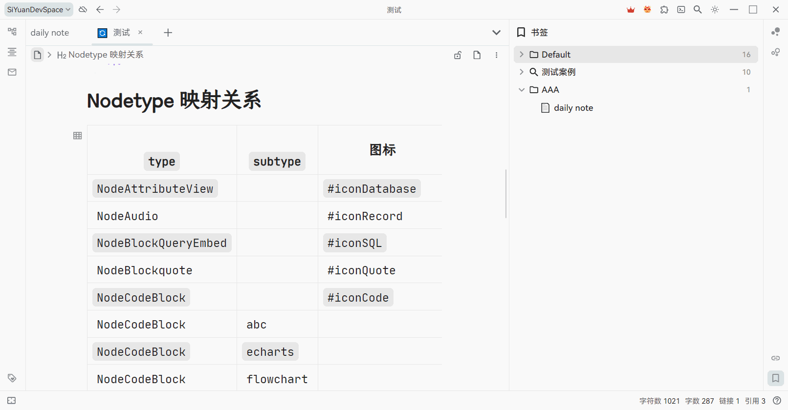
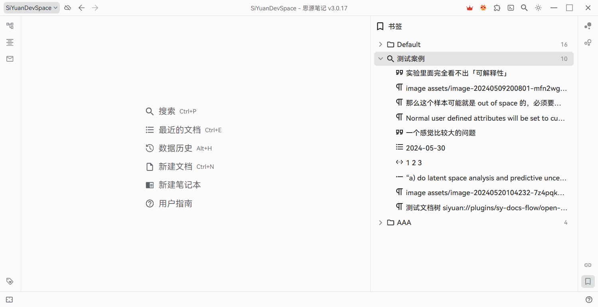
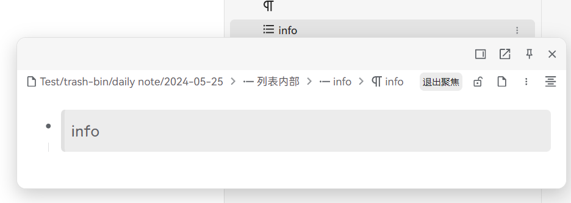
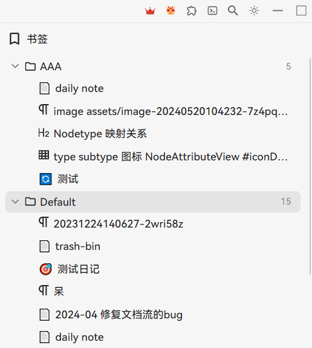
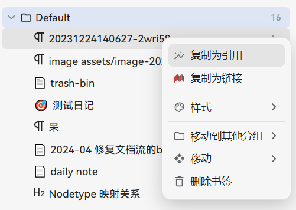
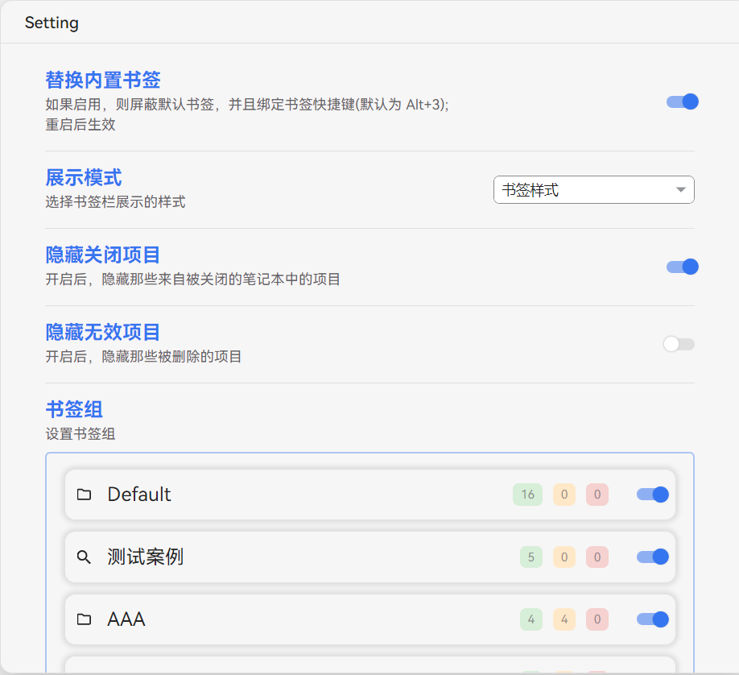
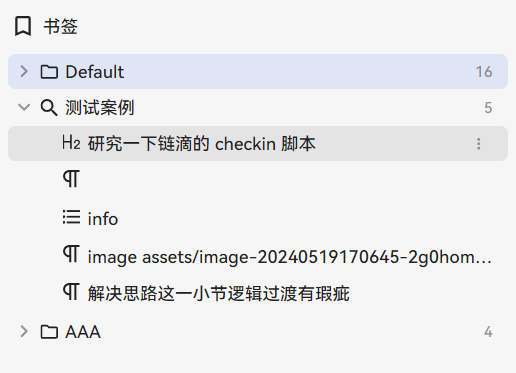
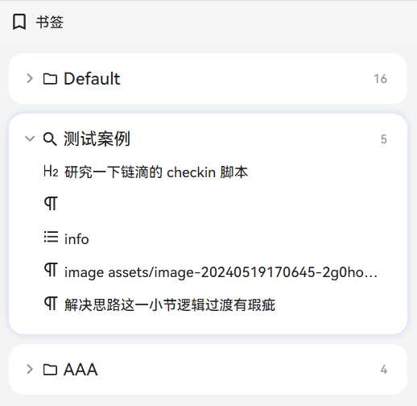

This plugin implements a more user-friendly bookmark feature, supporting drag-and-drop addition, bookmark group management, link copying, dynamic queries, and more.

> 🔔 Attention! By default, this plugin will hide the built-in bookmark button in the sidebar of SiYuan. You can disable this default behavior in the settings.

> ⚠️ Do not use this plugin on multiple devices at the same time. Concurrent edits are not merged and will be lost.

Below are the core functionalities. Please explore other detailed features on your own.

If you are satisfied with the plugin, welcome to visit our [Github page](https://github.com/frostime/sy-bookmark-plus) and star it!

📝 Changlog (in Chinese, however): [CHANGELOG.md](./CHANGELOG.md)

## Bookmark Groups

Click "Add" on the top bar to create a new bookmark group. Bookmark groups are classified into two types:

* Static Bookmark Group: A regular bookmark group where users can manually add or remove bookmark items

  * Supports custom drag-and-drop functionality
  * Supports moving items within the bookmark group to different groups
* Dynamic Bookmark Group: A query-based dynamic bookmark group that lists query results; supports the following rules:

  * SQL Query: Input SQL query statements
  * Backlinks: Input block ID to query the backlinks of the corresponding block; users can specify a post-processing scheme.

    1. **No Process**: Display the queried block directly as it is.
    2. **First child of container**: When the referenced block is the first child block of a list item or quote block, display the complete container block.
    3. **Display as document block**: Display the document containing the referenced block, rather than the referenced block itself.

    > Note: If you are confused or do not understand the "post-processing scheme," please refer to the [Q&amp;A section](#what-is-the-post-process-for-the-backlink-rule).
    >
  * Block Attribute: Query specified block attributes. You can input the block attributes you want to query, such as:

    1. ​`<Attribute>`​, e.g., `custom-b`​, returns all blocks containing the `custom-b`​ custom attribute
    2. ​`<Attribute>=<val>`​, e.g., `bookmark=test`​, returns all blocks within the "test" bookmark
    3. ​`<Attribute> like <val>`​
  * Javascript: Execute the written JavaScript code and return an array of `Block[]`​ or an array of `BlockId[]`​

    * Regarding JavaScript queries, please read the following explanations in detail.

​​

### Javascript Query

The code written in the JavaScript query will be placed in an `async`​ function, and it needs to return an array of `Block[]`​ (or an array of Block IDs).

```js
async function main(){
    ${inputCode}
}
return main();
```

In the code, an `kit`​ object can be accessed, which has some commonly used query functions built-in.

```js
const kit: {
    request: (url: string, data: any) => Promise<unknown>, // request backend api
    sql: (sqlCode: string) => Promise<unknown[]>; // fetch sql backend api
    backlink: (id: BlockId, limit?: number) => Promise<Block[]>;
    attr: (name: string, val?: string, valMatch?: '=' | 'like') => Promise<Block[]>
};
```

⭐ It is more recommended to be used in conjunction with the `Query & View`​ plugin, and use the `Query`​ provided by the plugin for querying. For example, the following code:

```js
let todo = await Query.task(Query.utils.thisYear(), 64);
return todo.sorton('created', 'desc');
```

## Adding Items

### Static Group

In a static bookmark group, you can add bookmark items through the following methods:

1. Editor Block Drag-and-Drop: In the editor, directly drag the block icon into the bookmark group
2. Tab Drag-and-Drop: You can directly drag the tab of the currently edited document into the bookmark group.

    ​​
3. Right-click Menu of the Bookmark Group:

    1. Add from Clipboard: You can copy a block's ID, reference, or link, and the plugin will automatically recognize and add it to the bookmark group
    2. Add Current Document Block: Adds the currently edited document to the bookmark group

​​

### Dynamic Group

Dynamic bookmark groups mainly acquire bookmark items by executing queries.

1. Global Update: Click the update button on the top bar to update all bookmark groups
2. Right-click Menu: Click the right-click menu of the dynamic group to re-execute the query in the current group and obtain the latest bookmark items

​​

### Variable Rendering

In dynamic groups, variable rendering is supported based on `{{VarName}}`​. Variable rendering allows you to insert dynamic variables into rules, which will be replaced with actual values during rendering. Currently supported variables include:

* ​`{{CurDocId}}`​: ID of the currently active document
* ​`{{CurRootId}}`​: Alias of `{{CurDocId}}`​
* ​`{{yyyy}}`​: Current year (four digits)
* ​`{{MM}}`​: Current month (two digits)
* ​`{{dd}}`​: Current day (two digits)
* ​`{{yy}}`​: Last two digits of the current year
* ​`{{today}}`​: Current date (equivalent to `{{yyyy}}{{MM}}{{dd}}`​)

Example 1, SQL rule: View all updates for the current month

```sql
select * from blocks where
type='d' and updated like '{{yyyy}}{{MM}}%'
order by updated desc
```

Example 2, Attribute rule: View all daily notes for the current month

```
custom-dailynote-% like {{yyyy}}{{MM}}%
```

Example 3, Backlink rule: View backlinks that refer to the current active document:

```
{{CurDocId}}
```

You can enable the "**Refresh when switching documents**" feature in the bookmark settings. So it will automatically refresh dynamic bookmark groups that contain the current-document variable when you open new documents; each dynamic group can also be set to "Always refresh" or "Never refresh" in its edit dialog.

​​

## Bookmark Items

* Click an item to navigate to the corresponding block
* Hover over the block icon to preview the block's content

  ​​
* Drag the item and move to other group

  ​​
* More features are available in the right-click menu~

  ​​

## Bookmark Sub Views (version 2.0)

Version 2.0 introduces a new feature called **Bookmark Sub Views**, designed to address the issue of sidebar clutter caused by stacked bookmark groups. Now you can:

1. Create an independent sidebar by going to Settings → "Sub View Management."  
    ​​
2. Freely assign bookmark groups to different views: Each sub-view can contain numbers of bookmark groups

    ​​
3. The view will be fixed to an independent Dock panel after restart SiYuan.

## Plugin Settings

​​

* Replace Built-in Bookmarks: If enabled, the plugin will automatically block the default SiYuan bookmarks at startup and override the bookmark shortcuts (default is Alt + 3)
* Display Styles: The plugin provides two styles (views)

  * Bookmark View: Same as the built-in bookmarks of SiYuan

    ​​
  * Card View: Each bookmark group is presented in a card style

    ​​
* Hide Items: Bookmark items may not be indexed due to being deleted or the notebook containing the block being closed

  * Hide Closed Items: When enabled, hide items from closed notebooks
  * Hide Invalid Items: When enabled, hide deleted items
* Bookmark Groups

  * Displays all bookmark groups
  * Adjust the order of bookmark groups by dragging with the mouse
  * You can hide temporarily unnecessary bookmark groups by deselecting their display

## Styling

Each component within the plugin has a specific `class`​ name. If customization is needed (e.g., modifying fonts), you can write your own CSS styles and place them in SiYuan's "Code Snippets".

* Top-level: `.custom-bookmark-body`​

  * Card mode: `.custom-bookmark-body.card-view`​
  * Background color in card mode is based on two CSS variables:

    * Base background color: `--fmisc-bookmark-body-bg__card-view`​, default is `var(--b3-theme-surface-light)`​
    * Card background color: `--fmisc-bookmark-group-bg__card-view`​, default is `var(--b3-theme-background)`​
* Each bookmark group: `.custom-bookmark-group`​

  * Bookmark group header: `.custom-bookmark-group-header`​
  * Bookmark list: `.custom-bookmark-group-list`​
* Each bookmark item: `.custom-bookmark-item`​

Example:

* Modify the font of bookmark items

  ```css
  .custom-bookmark-item.b3-list-item {
    font-size: 20px;
    line-height: 24px;
  }
  ```
* Modify the card background color:

  ```css
  :root {
      --fmisc-bookmark-body-bg__card-view: white;
      --fmisc-bookmark-group-bg__card-view: grey;
  }
  ```

## `BookmarkPlusSDK`​

After version 1.4.1 of the plugin, the plugin will globally mount a variable `BookmarkPlusSDK`​, which can be used to list the items in the bookmark groups.

* ​`BookmarkPlus.SDK.listGroups()`​: Lists all bookmark groups, each bookmark group contains

  * ​`id`​
  * ​`name`​
  * ​`expand`​: The collapsed state of the bookmark group
  * ​`hidden`​: Whether the bookmark group is hidden
  * ​`type`​: normal or dynamic
* ​`BookmarkPlus.SDK.listItems(id: string)`​: Pass in the ID of the bookmark group and return the IDs of all the blocks in the bookmark group

## 🤔 Q&A

### What is the "Post process" for the "Backlink" rule?

**Display as document block** is relatively straightforward. It means that the document itself from which the referenced block comes is displayed, rather than the referenced block itself. If multiple referenced blocks come from the same document, only one document block item is displayed, without repetition.

The meaning of **First child of container** is: if the queried block is the first paragraph block of a container block (like: list item block, block quote block), we will consider it as having queried the container block itself.

​​

Here is an example: a list item references `DocumentX`​.

```md
- Foo
- [[DocumentX]]
  - AAA
  - BBB
- Boo
```

If using SQL to query the backlink of DocumentX, it will eventually got the **paragraph block** `[[DocumentX]]`​, which is:

```md
[[DocumentX]]
```

However, if the user enables the "First child of container" post-processing scheme, the bookmark display will show the complete list item block itself.

```md
- [[DocumentX]]
  - AAA
  - BBB
```

### Is there a way to import items from the built-in bookmarks of SiYuan?

* Create a new bookmark group
* Select Dynamic Group and Attribute Rule
* Fill in `bookmark`​ or `bookmark=<bookmark name>`​ in the attribute rule

### Can I modify the display title of bookmark items?

* Simply add block `name`​ attribute to blocks.
* When bookmark items are displayed, if a `name`​ is available, it will be displayed first. Otherwise, the `content`​ of the block will be displayed.

### What does the "Refresh" button in the top bar do?

* For dynamic groups, it re-executes the query and displays the most recent query results.
* For static groups, it checks the current status of each item (block) and updates them based on the latest results.

### Can plugins be used on mobile devices?

> Note: On mobile devices, it will not be possible to replace the built-in bookmark functionality. It can only be accessed separately through the plugin panel.

​​

However, since plugin development is done on the desktop, some operations on mobile devices may be less convenient.
